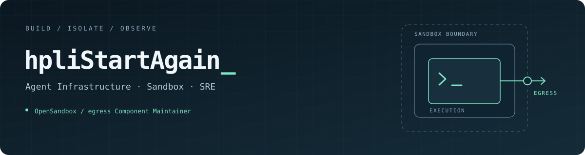

<picture>
  
</picture>

### Hi, I'm hpliStartAgain 👋

I work on **agent infrastructure, sandbox runtimes, and SRE**. My focus is on how agents run code, reach external services, and stay observable.

目前主要在折腾 Agent 基础设施、沙箱运行时，以及让运维更省心的工具。

- **Open source:** [OpenSandbox](https://github.com/opensandbox-group/OpenSandbox) **egress Component Maintainer** · [maintainers](https://github.com/opensandbox-group/OpenSandbox/blob/main/MAINTAINERS.md) / [component ownership](https://github.com/opensandbox-group/OpenSandbox/blob/main/.github/CODEOWNERS)
- **Building:** sandbox lifecycle, microVM-based execution, and controlled network access.
- **Exploring:** observability and agents that help with everyday operations.

### Selected work

<table>
<tr>
<td width="50%" valign="top">
<h3>↗ <a href="https://github.com/opensandbox-group/OpenSandbox">OpenSandbox</a></h3>

Sandbox infrastructure for AI applications. I maintain the egress component and contribute to the project.

EGRESS · NETWORK POLICY · AGENT INFRA
</td>
<td width="50%" valign="top">
<h3>▧ <a href="https://github.com/hpliStartAgain/fast-sandbox">Fast Sandbox</a></h3>

A Kubernetes sandbox runtime with Firecracker microVMs, snapshot-based startup, and warm capacity.

KUBERNETES · FIRECRACKER · SNAPSHOTS
</td>
</tr>
<tr>
<td width="50%" valign="top">
<h3>⌘ <a href="https://github.com/hpliStartAgain/minibox">minibox</a></h3>

A small Linux container sandbox prototype in Go. Learning runtime internals by building them.

GO · LINUX NAMESPACES · PROCESS LIFECYCLE
</td>
<td width="50%" valign="top">
<h3>✦ <a href="https://github.com/hpliStartAgain/memospark">MemoSpark</a></h3>

Spaced repetition, flashcards, and coding practice, with an MCP interface for AI assistants.

JAVA · TYPESCRIPT · MCP
</td>
</tr>
</table>

### Areas I care about

**Isolation & access control** · **Runtime lifecycle** · **Observability** · **Operational automation**

从实际问题出发，把系统做扎实。
